<p align="center">
  
</p>

```diff
+ what I do
  senior front-end engineer · 8+ years · vue, nuxt, react, next, typescript
  cross-platform apps with flutter and .net + avalonia · back end in node and nest
  ai agents and llm workflows · mcp servers · claude code, codex, cursor

+ what you get
  interfaces that ship on time and stay easy to change
  accessible by default (WCAG 2.0 AA) · typed · tested · documented

- what you don't get
  a rewrite six months later
```

### `~/worked-with`

<table>
<tr>
<td align="center" width="260"><a href="https://www.brickabode.com/"></a><br><b>Brick Abode</b><br><sub>home base · remote</sub></td>
<td align="center" width="260"><a href="https://www.yubico.com/"></a><br><b>Yubico</b><br><sub>now · .NET + Avalonia</sub></td>
<td align="center" width="260"><a href="https://hellosona.ai/"></a><br><b>Sona AI</b><br><sub>Flutter + AI agents</sub></td>
</tr>
<tr>
<td align="center" width="260"><a href="https://www.library.ucla.edu/"></a><br><b>UCLA Library</b><br><sub>site + design system</sub></td>
<td align="center" width="260"><a href="https://www.vivo.com.br/"></a><br><b>Vivo</b><br><sub>legal platform</sub></td>
<td align="center" width="260"><a href="https://www.doble.com/"></a><br><b>Doble</b><br><sub>engineering lab platform</sub></td>
</tr>
</table>

### `~/highlights`

- **90k+ developers** reached by my articles in PT and EN — most read: [How to increase your rendering performance by 70% in Vue.js](https://dev.to/matheusgomes062/how-to-increase-your-rendering-performance-by-70-in-vue-js-4dia)
- **Talks** at the UCLA dev jam: building a Vue component library with Rollup, and Cypress testing
- **IBM hackathon** (COVID-19 health track): 2nd in Brazil, 4th in Latin America
- [**Guia Markdown**](https://github.com/matheusgomes062/guia-markdown) — a free book about Markdown, written in Markdown

### `~/education`

- **MBA in Software Engineering** — USP/Esalq
- **Postgraduate in Data Science** — Descomplica
- **MBA in Entrepreneurship and Innovation** — Cruzeiro do Sul
- **B.Sc. in Science and Technology** (Computer Science track) — Unifesp
- [**Machine Learning**](https://www.coursera.org/account/accomplishments/certificate/S6WESDPUTC9T) — Stanford Online

### `~/side-projects`

- [**tv-gominho**](https://github.com/matheusgomes062/tv-gominho) — a 2000s-style cartoon channel: turn it on and something is already playing · PC, Raspberry Pi, USB · GPL-3.0

### `~/wip`

- **lexoring** — translate and fix selected text in any Windows app · Rust
- **transmiteai** — invite-only screen sharing over WebRTC, no sign-up · Svelte + Cloudflare Workers

### `~/writing`

<!-- BLOG-POST-LIST:START -->
- [🧠 System Design: Foundations, Scaling Strategies, and Resilience Patterns](https://dev.to/matheusgomes062/system-design-foundations-scaling-strategies-and-resilience-patterns-1b79)
- [Code Smells: Long Methods](https://dev.to/matheusgomes062/code-smells-long-methods-5f2p)
- [TypeScript: An Introduction to the Statically Typed Superset of JavaScript](https://dev.to/matheusgomes062/typescript-an-introduction-to-the-statically-typed-superset-of-javascript-4hgo)
<!-- BLOG-POST-LIST:END -->

<p align="center">
  <a href="https://mgomes.dev"></a>
  <a href="https://www.linkedin.com/in/matheus-gomes-dev/"></a>
  <a href="https://dev.to/matheusgomes062"></a>
  <a href="mailto:me@mgomes.dev"></a>
</p>
